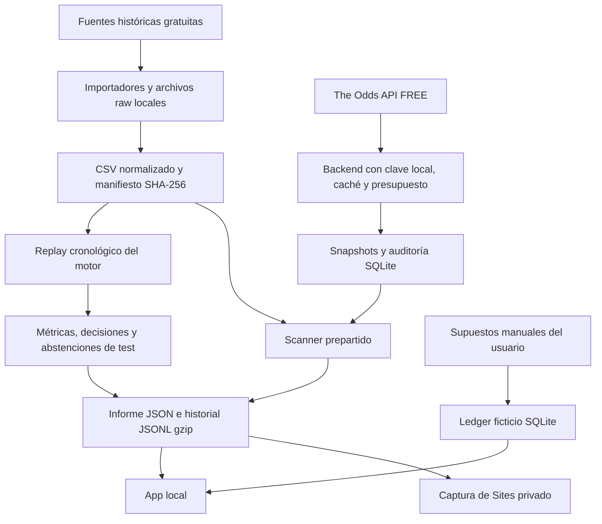

# Arquitectura de Kraken Edge

El sistema separa resultados, probabilidades, precios observados, decisiones históricas y simulaciones manuales. Esto permite reproducir qué información existía al estimar un partido y evita presentar una captura de cuotas como una apuesta ejecutada.

## Flujo de información

No hay un componente de envío de apuestas. La salida actual del scanner es observación bloqueada, con `execution_enabled=false` e importe cero.

## Ingesta y procedencia

`scripts/download_history.py` descarga fútbol/NBA, próximos partidos y eventos seleccionados. `scripts/download_us_sports.py` incorpora MLB desde los ZIP que Retrosheet ofrece expresamente para descarga. Deben ejecutarse en ese orden: el segundo extiende la tabla canónica que reconstruye el primero.

Los originales permanecen en `data/raw/`; `data/manifest.json` registra URL, fecha de recuperación, Last-Modified disponible, tamaño, filas y SHA-256. Las tablas derivadas se escriben atómicamente en `data/processed/`. La normalización conserva ausencias y procedencia: una fila sin cuotas continúa sin cuotas.

La clave de partido es estable. MLB conserva el número de juego de las dobles jornadas y fecha los suspendidos al completarse, manteniendo la fecha inicial por separado. La neutralidad desconocida permanece desconocida. Los alias de franquicia sólo estabilizan identidades; no incorporan información deportiva futura como predictor.

El contrato común incluye deporte, liga, fecha, participantes, marcador final, odds cuando existen y su fuente. Los metadatos distinguen pre-closing, closing y media de mercado. Una media es un benchmark, no una oferta individual ejecutable. Nunca se sustituyen cuotas ausentes por el máximo entre fuentes incompatibles.

## Motor matemático y evaluación

`engine/core.py` implementa Poisson regularizado por liga para fútbol, Elo básico para deportes binarios, remoción proporcional del margen, EV, Kelly, sensibilidad y comprobaciones teóricas de arbitraje. El cálculo de primer gol de equipo es exploratorio; no identifica un goleador individual.

`engine/report.py` reproduce los partidos por fechas. Todas las predicciones de un día se calculan antes de actualizar el estado con sus resultados. La división temporal por deporte usa 60 % entrenamiento, 20 % validación y 20 % test. Actualizar con resultados de fechas anteriores dentro del replay no permite acceder al futuro ni a resultados de la misma fecha.

Las métricas probabilísticas y la comparación con mercado utilizan observaciones compatibles. No se calcula ROI para NBA/MLB sin cuotas históricas. Los promedios `Avg` se excluyen de la estrategia simulada porque no representan una casa concreta. Los modelos, umbrales, semillas y particiones quedan declarados en el informe; una banda de sensibilidad individual no se etiqueta como confianza estadística calibrada.

La primera estrategia de fútbol usa un único resultado por evento, EV mínimo 5 %, cuarto de Kelly, tope 1 % del saldo y exposición diaria máxima 3 %. Su ROI negativo y drawdown elevado justifican mantener el estado de investigación. Las métricas de otro deporte o mercado no rehabilitan esa estrategia.

## Precios actuales y scanner

`backend/providers.py` lee `ODDS_API_KEY` desde el proceso o `.env`. La clave sólo se usa en el servidor. Los mensajes de error y la UI no incluyen la URL privada del proveedor.

El adaptador limita regiones y mercados, reserva créditos antes de consultar y almacena la respuesta en SQLite. La caché de precios dura seis horas; el catálogo, un día. El límite local máximo es 450 reservas por mes UTC, dentro del plan de 500 créditos. El contador local es prudente y no sustituye la cuota reportada por el proveedor.

`scripts/scan_odds.py --all-active` consulta una vez cada competición activa sin futuros, hasta el límite solicitado. Es una tarea manual acotada. El endpoint `upcoming` sólo cubre eventos live y los ocho próximos de distintos deportes. La disponibilidad de un catálogo no es disponibilidad de un histórico/modelo.

`backend/scanner.py` reúne snapshots, conserva línea y participante, descarta mercados lay para no mezclarlos con back, y sólo considera futuros para los modelos prepartido. Para el benchmark 1X2 necesita todos los resultados de la misma casa. Los participantes deben coincidir exactamente con el histórico; no se unen equipos por similitud aproximada de nombres.

Los precios con actualización desconocida, anterior a 15 minutos o incoherente quedan señalados. Un historial de más de 45 días, muestra insuficiente, identidad incierta o reglas sin verificar impiden usar su probabilidad como actual. La política global sigue bloqueada aunque una cuenta dé EV positivo.

Los props se obtienen por evento. El scanner conserva el precio observado y deja probabilidad/EV desconocidos cuando falta un modelo de ese contrato. Una lista parcial de goleadores no es un espacio exhaustivo de resultados. No se elimina el margen sobre esa lista ni se supone independencia entre selecciones.

## Ciclo diario del bot

`bot.py --once` realiza una pasada acotada. `--watch` mantiene un proceso que repite con intervalo mínimo de 24 horas; no es un servicio instalado ni se inicia con la app web. Un bloqueo de kernel `flock` evita dos instancias simultáneas. No se dejó un proceso watch ni una tarea programada activos durante la creación.

La selección combina hasta cuatro prioridades activas (Argentina, Brasil, EPL y NBA) con ocho competiciones en rotación según fecha UTC. Sólo usa `h2h`, una región, sin futuros. `data/runtime/bot_state.json` registra los intentos antes del acceso a red y limita a doce por fecha UTC, incluso después de un error o reinicio. El adaptador mantiene además su caché y el presupuesto mensual compartido con las consultas manuales.

Cada ciclo guarda el estado, audita `bot_cycle`, archiva un scan y actualiza `report.live` atómicamente. No cambia la política de investigación ni publica Sites automáticamente. Si no existe informe histórico, registra que hace falta `scripts/build_report.py`.

`--refresh-data` es opt-in: una vez por fecha UTC refresca fútbol de la temporada europea actual y los cuatro archivos ARG/BRA/USA/MEX, normaliza desde las cachés y vuelve a incorporar Retrosheet. Sólo un cambio del hash del conjunto histórico, o la ausencia del informe, dispara un backtest nuevo. NBA/MLB conservan sus cortes de archivo. El pipeline guarda una copia coherente previa y la restaura si falla la reconstrucción; las fuentes raw nuevas se retienen y los errores parciales quedan identificados.

## Persistencia y auditoría

`backend/storage.py` inicializa `data/runtime/kraken.sqlite3` con tablas para:

| Tabla | Función |
| --- | --- |
| `snapshots` | Última respuesta por clave de consulta. |
| `snapshot_history` | Versiones anteriores de respuestas. |
| `quota` | Reservas de consumo por mes UTC. |
| `scan_history` | Exploraciones con identificador y resultado completo. |
| `audit` | Acciones y metadatos de operación. |
| `settings` | Parámetros del ledger manual. |
| `paper_bets` | Posiciones ficticias y liquidaciones. |

Las reservas y el ledger usan transacciones SQLite. `backend/paper.py` verifica capital ficticio, importe máximo y exposición agregada del mismo evento; no trata dos mercados del mismo partido como apuestas independientes. Un UUID de solicitud evita duplicar una posición. Una liquidación repetida idéntica es estable; una contradictoria se rechaza.

`save_scan` conserva también archivos en `data/runtime/reproducibility/`: CSV históricos comprimidos, sus SHA-256 y una copia comprimida de las fuentes del modelo `core.py`/`report.py`. El registro de exploración enlaza a esos archivos, además de guardar los snapshots de precios en SQLite. Así, un hash sigue siendo útil después de una corrección del proveedor o un cambio del motor.

La simulación manual y el replay histórico son registros distintos: modificar el bankroll manual no cambia un backtest ya generado. Las probabilidades manuales conservan su origen explícito.

## Informe y dos modos de interfaz

`scripts/build_report.py` combina el replay con la exploración de la caché y los catálogos. Escribe `app/data/report.json`; el historial completo se entrega como JSONL gzip con recuento. La UI empieza con una muestra pequeña y carga la exportación completa bajo demanda. La etiqueta visible aclara a qué conjunto se aplican filtros y exportaciones.

`server.py` sirve exclusivamente `app/` y expone `/api/*` en loopback. Valida JSON, tamaño, Host y Origin de las mutaciones. Los archivos privados quedan fuera de la raíz de publicación. No es un servidor multiusuario expuesto a internet.

[Sites publicado](https://kraken-edge-joaquin.lemony-rhino-7323.chatgpt.site) utiliza artefactos estáticos con acceso privado del propietario. Ese despliegue conserva el momento de captura; no recibe `.env`, SQLite ni los CSV originales. Al no incluir el backend, las consultas de proveedor y las modificaciones del ledger se realizan en la app local. La actualización de Sites requiere una nueva generación y publicación del snapshot.

## Límites y extensión

La arquitectura permite añadir adaptadores y modelos, pero cada combinación deporte/mercado necesita procedencia, definición de liquidación, evaluación temporal y calibración propias. Un conector disponible no declara por sí solo un modelo listo.

Los tests del motor cubren cálculos e invariantes temporales; los del backend cubren persistencia, presupuesto, entradas y ledger. No requieren una clave real. El detalle científico está en [METHODOLOGY.md](METHODOLOGY.md) y las fuentes/licencias en [DATA_SOURCES.md](DATA_SOURCES.md).
